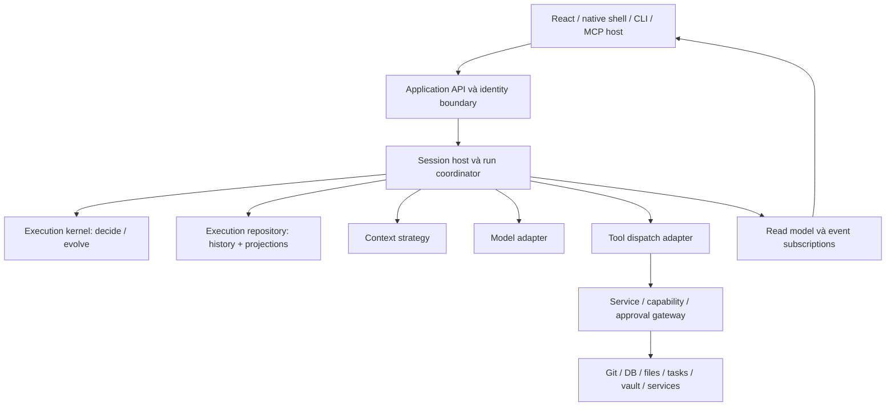

# Kiến trúc và ranh giới

Trạng thái: foundation design v0.12, chưa implementation. Phạm vi và bất biến chung ở [Core harness](/dev-kit/core-harness).

## 1. Mô hình kiến trúc



Đây là ranh giới logic, không phải đề xuất tạo một package cho mỗi ô. `internal/app` tiếp tục là composition root. UI/transport chuyển đổi DTO và hiển thị; chúng không sở hữu loop, policy, transcript hoặc recovery.

Provider adapter gọi model trực tiếp là năng lực mới của runtime tương lai. Việc đưa nó vào hệ thống MUST đi qua session lifecycle, account, scope, budget và activation path được review; không được xem là một đường gọi mạng ngoài quản lý của DevKit.

## 2. Command, decision, event và effect

| Khái niệm | Ví dụ | Semantics |
| --- | --- | --- |
| Command | Bắt đầu run, yêu cầu hủy, chấp nhận completion của một invocation | Ý định hoặc đầu vào; có thể bị từ chối hoặc nhận lại kết quả đã xử lý |
| Decision | Được bắt đầu model request tiếp theo; phải chờ approval | Kết quả kiểm tra state và facts đầu vào |
| Domain event | Run đã được nhận, invocation đã được lên lịch, kết quả đã được ghi nhận | Sự kiện đã commit trong execution history |
| Effect intent | Yêu cầu gọi model hoặc dispatch tool có identity cụ thể | Công việc cần thực hiện, chưa chứng minh đã thực hiện |
| Observation | Adapter báo nhận phản hồi hoàn chỉnh hoặc tool kết thúc | Bằng chứng đầu vào cần validate, fence và commit |

Tên event MUST phản ánh điều host biết. `ToolDispatchStarted` chỉ chứng minh host đã bắt đầu dispatch; `ToolResultRecorded(outcome=success)` cần observation hợp lệ từ executor. “Model đã nói thành công” không đủ làm observation thành công của tool.

Kernel có hai hợp đồng logic:

```text
decide(state, command, explicitFacts) → events / rejection
evolve(state, committedEvent)        → nextState
```

Các hàm này MUST không gọi network/OS/SQL, không tự đọc đồng hồ, không sinh random ID, không đọc policy hiện tại. ID, time, policy observations và budget observations được host cung cấp tường minh. Model/context strategy có hành vi không xác định MUST có kết quả cần thiết được ghi nhận trước khi dùng làm cơ sở transition.

`evolve` dùng dữ kiện lịch sử để dựng lại state. Nó không đánh giá lại quyền hiện tại để sửa quá khứ. Việc có được thực thi một bước tiếp theo hay không là command mới, đi qua kiểm tra hiện tại.

## 3. Protocol một bước xử lý

1. Host xác thực caller, đọc state/revision và thu thập facts từ owning services khi cần.
2. Kernel kiểm tra command và tạo các event mô tả quyết định; event chỉ là dự kiến cho đến commit.
3. Chỉ owner coordinator được yêu cầu repository append; Queued accept/cancel dùng queue-owner revision, mọi execution transition sau admit cần session admission token. Transaction kiểm tra revision/dedup/fence, append event batch và cập nhật projections: control state suy ra, native transcript, timer và execution intents. Intent không có đường ghi độc lập.
4. Coordinator giữ chỗ worker capacity trước dispatch transaction (không chạy effect), rồi commit `ModelDispatchStarted` hoặc `ToolDispatchStarted` kèm budget reservation trước khi giao work item vào slot đã giữ; không có worker tự claim SQL row. Hết capacity thì chờ local scheduling, không ghi dispatch hoặc kết quả cancelled. Commit thất bại/stop trước dispatch thì trả slot; commit unknown giữ slot cho đến read-back, không handoff khi chưa rõ kết quả.
5. Worker kiểm tra cancellation và đi qua execute boundary của gateway hiện tại với receipt một lần (nếu cần approval), gọi adapter/service ngoài transaction, rồi trả observation. Gateway revalidate authority nhưng không hỏi lại một approval còn hợp lệ cho chính dispatch đó.
6. Observation trở về coordinator như command có invocation/attempt identity; coordinator validate và append kết quả theo cùng protocol. Worker, timer scheduler và UI không append stream.

Không giữ transaction, coordinator lock hay mutex chuyển state trong thời gian chờ model, tool, approval hoặc child. Mỗi callback chỉ chiếm quyền xử lý đủ lâu để commit một transition. Chờ worker capacity cũng không được giữ coordinator lock hoặc chặn stop commands: reserve non-blocking, rồi schedule lại khi capacity có sẵn.

Commit không rõ kết quả MUST được read-back bằng command/event identity trước bước tiếp theo. Không dispatch từ kết quả commit chưa xác định và không tạo intent mới để “thử lại”. Xem [transaction và recovery](/dev-kit/core-harness/event-storage-recovery).

Không dùng subscription của UI làm cơ chế duy nhất kích hoạt execution. Mất một notification không được làm mất intent đã commit.

## 4. Ownership và nơi giữ sự thật

| Thông tin | Owner / nguồn có thẩm quyền | Core được giữ |
| --- | --- | --- |
| State của run/model request/tool invocation | Execution repository của session host | Event history và projection cùng owner |
| Session queue/pause và pre-admission revision | Session host/session owner (queue owner) | Queue decision reference và revision; không tự drain recovered work |
| Process incarnation và quyền mở execution store | Host lifecycle owner giữ exclusive data-directory lock | Lock-generation/owner reference; không dùng PID hoặc timeout làm stop proof |
| Identity, workspace, quan hệ cha/con, runtime incarnation | Agent Hub và identity/session services | Reference và observation có revision |
| Capability, environment confirmation, sandbox | Owning gateway/service | Kết quả kiểm tra dùng cho một bước, không có quyền tái sử dụng vô hạn |
| Approval/question | Interaction và service sở hữu yêu cầu | Reference, lifecycle observation và recovery metadata được phép |
| Tool groups / effective configuration | `harness` / `harnessconfig` cùng host publication | Binding/version đã resolve; không thêm resolver thứ hai |
| Task, acceptance, branch ownership | Tasks, Git và managed-work owners | Task/attempt IDs và evidence references |
| Peer delivery | Peer outbox hiện hữu | Delivery reference và observation; không outbox song song |
| Canonical transcript native | Projection cùng transaction với execution events | Responses/results được chọn và immutable payload refs |
| Vendor transcript / attachments / artifacts | Store hiện hữu phù hợp trong session domain | Không tự migrate vendor history hoặc giả có native atomicity |

Sự kiện lịch sử “approval đã được cấp” và quyền thực thi hiện tại có semantics khác nhau. Approval có thể đã hết hạn, bị consume, vault đã khóa hoặc scope đã đổi. Tool executor MUST dùng gateway hiện hành; không dựng một cache quyền từ journal.

### Approval qua owning gateway

Hiện tại không có một confirm gateway duy nhất: MCP adapters, app wiring và domain services gọi `Hub.Confirm`/`ConfirmDecision` qua nhiều đường đồng bộ và có thể giữ lời gọi chờ câu trả lời. Lifecycle bất đồng bộ đề xuất **chưa được hỗ trợ đồng đều bởi các đường đó**. G-04/G-05 MUST chốt việc tách cùng gateway thành ba bước: **check → request approval → execute với receipt một lần**; không thêm runner hoặc một approval owner trong kernel.

Check validate identity, capability, exact canonical args, target/environment revisions và xác định cần hỏi hay không. Interaction owner tạo/ensure request có operation identity và trả receipt; coordinator chỉ lưu reference/observation. Receipt bị bind với caller/session/workspace, invocation/attempt/**check generation**, args, target/environment revisions, expiry và process incarnation. Execute atomically validate/claim receipt, recheck current grants, vault, scope và environment rồi mới qua effect boundary; receipt không được replay hoặc dùng cho attempt khác. Receipt/claim có read-back theo operation identity; claim/consume chưa rõ thì fail closed và đối soát, không dùng lại để dispatch. Nếu authority/revision thay đổi, từ chối receipt cũ; muốn tiếp tục phải check/request mới.

Với `EnvBlocks` (prod hoặc tag không rõ), mỗi execution cần một approval mới; không dùng allow-always hoặc scoped approval. Một receipt hợp lệ chỉ chứng minh lời hỏi bắt buộc cho **chính execution đó** đã được owner giải quyết, nên execute không hỏi lần hai. Kernel không được tự cấp receipt hoặc bật cờ bỏ confirmation. Host headless tiếp tục fail closed; không có client nào đang nối thì request chờ ([interaction](/dev-kit/core-harness/interaction) I-07).

Scoped approval vẫn chỉ dành cho exact `db.query`, hữu hạn lượt/thời gian và bị invalidate khi vault lock/restart. Theo semantics hiện tại của `reserveApproval`/`StartScopedApproval`/`CancelScopedApproval`, check có thể giữ chỗ một lượt nhưng MUST NOT tiêu lượt; consume atomically tại external effect boundary sau current-authority revalidation. Refusal/stop trước boundary trả reservation; crash trước boundary không tạo consumption. Restart invalidate cả approval/reservations, không khôi phục lượt thành grant mới. Crash sau consume nhưng trước effect/result vẫn có thể mất một lượt và thành unknown; không hứa atomicity xuyên owner/external effect. Execution journal chỉ quan sát receipt, không là approval ledger. Chi tiết receipt protocol và các crash windows là gate G-04/G-05.

**Selection cũng là approval-class interaction.** Tool đang chạy mà thiếu active profile (database/SSH/Kafka `EnsureActive`), cần chọn Git remote account, chọn tool-group scope hoặc trả lời group request hiện mở selection chặn đồng bộ trong worker. Với native runtime, selection phải đi cùng check → request → execute như confirmation: owner tạo request **trong memory theo incarnation** (D-16; journal và audit là sự thật bền) có operation identity, trả receipt bind lựa chọn với invocation/attempt/check generation và revisions; worker không giữ slot chờ người dùng; restart dùng `ToolCheckReset`, không khôi phục lựa chọn cũ thành answerable. Lựa chọn của user không cấp quyền thực thi; confirmation bắt buộc của profile/environment vẫn là bước riêng.

G-04 là gate **theo từng tool và toàn bộ execution call graph**, không phải đổi một facade rồi coi mọi handler tương thích. Inventory source hiện tại có các confirmation sites: `internal/mcp/gate.go` (generic profile, scoped và ad-hoc confirmation), `tools_pr.go`, `tools_agenthub.go` (nhiều call sites), `tools_apiclient_write.go`, `tools_workspace.go`; `internal/tasks/gate.go`; `internal/app/wiring.go` (database/Git confirmers); `internal/apiclient/service.go`; `internal/app/harness_config.go`; `internal/ops/ops.go` generic operation confirmer, `internal/git/confirmation.go` fallback Confirm và `internal/harnessconfig/apply.go` proposal confirmer. `db.query` qua `internal/mcp/tools_database.go` đã có reserve/start scoped approval, **chưa chứng minh** có asynchronous request/one-use receipt cho mọi loại approval.

Native dispatcher MUST mặc định không mở tool chưa có evidence toàn đường: schema/input/grants/context/resource guards, mọi nested confirmation owner, request/receipt/check-generation read-back, execute boundary, error/result budgets và môi trường. Binding/registry chỉ đánh dấu native-compatible theo version sau khi test đủ đường dev/prod/unknown tag và nested calls; tool không cần confirm cũng phải được review không có nested gate chưa hỗ trợ. Tool chưa tách luồng MUST không được advertise/dispatch cho native run; vendor path cũ tiếp tục như hiện tại. Không vừa pre-approve trong kernel rồi gọi nguyên blocking handler (hỏi đôi), không truyền boolean “already approved” để bỏ gate. Các owners phải expose receipt-aware path chung và giữ semantics cho caller hiện hữu; adapter không bypass owning service. Inventory đầy đủ các direct prompt call sites và classification được ratchet bằng `internal/arch/prompt_sites_test.go` (mọi production Go build variants trong root/internal/cmd). Tập prompt API được **suy ra từ chính `interaction.Hub`**: mọi method chạm tới `h.wait`, trực tiếp hoặc qua method prompt khác — hiện gồm `Confirm`/`ConfirmDecision` và các selection `SelectProfile`, `SelectAccount`, `SelectHarnessScope`, `SelectGroupRequestAnswer` — cộng các confirmer wrapper tên `Confirm`/`ConfirmDecision`. Prompt mới thêm vào hub tự bị ratchet; thêm/xóa hoặc đổi số calls phải cập nhật review. Tất cả 23 sites hiện native-blocked, scoped-only hoặc shared-blocking-primitive; không entry nào chứng minh native compatibility. Test cú pháp không là call-graph proof, không phát hiện alias/indirect call hoặc prompt ngoài hub có tên khác; G-04 vẫn phải audit các wrapper (kể cả ConfirmGit) và đường thực thi đầy đủ. Inventory này là baseline để audit, không là allowlist runtime.

Các effect gọi task handoff hoặc gửi peer message MUST ủy quyền cho đường hiện hữu và tham chiếu identity của nó. Execution intent không được biến thành managed ledger, peer delivery queue hoặc approval ledger mới.

### Vault observation là prerequisite mới

Source hiện tại: vault.Service.IsLocked chỉ trả bool; vault owner chưa có revision/subscription. Bridge vault methods hiện gọi Interaction.SetVaultLocked sau setup/unlock và trước lock. Đó là wiring của adapter, không đáp ứng owner-bound consistent-view contract cho native/CLI host. Tài liệu này **yêu cầu API mới, chưa có implementation evidence**: vault owner cung cấp Snapshot/Subscribe logic với owner incarnation + monotonic revision, state-only events và atomic snapshot/subscription cursor hoặc register-before-read/catch-up không mất transition; không publish key/password/payload. Revision cập nhật tại owner cho mọi state transition (setup, password/recovery unlock, lock), callback ngoài vault mutex; subscriber chậm không được giữ crypto lock hoặc chặn lock.

Application composition dùng owner observation để cập nhật shared interaction approval invalidation và coordinators cho mọi host; adapter chỉ gọi owner API, không là nguồn duy nhất phát lifecycle. Đặc biệt lock phải invalidate receipt/scoped approval và ngăn execute ngay tại owner/service boundary, không đợi UI hoặc notification bất đồng bộ đến nơi. Thứ tự publication, failure/backpressure/resync và lock-vs-consume linearization phải được thiết kế/test ở G-03/G-05 trước native activation; không coi polling bool, bridge event hoặc revision do adapter tự gán là evidence. Đây là prerequisite owner API/wiring, không phải chỉ UX G-07.

## 5. Port và extension contracts

Tên bên dưới là tên logic, chưa chốt Go interface signatures.

| Port / strategy | Trách nhiệm | Ràng buộc |
| --- | --- | --- |
| Model adapter | Chuyển request chuẩn hóa sang provider; stream và chuẩn hóa completion/error/usage | Giữ khác biệt provider tại adapter; không tự dispatch tool, không bật provider-hosted tools v1 hoặc cập nhật state run |
| Context builder | Chọn messages, references, compaction và tool declarations | Có budget; đầu vào/phiên bản có thể truy vết; không tự cấp tool/quyền |
| Tool dispatcher | Resolve declaration, validate input và đi qua đường service/gateway được kiểm soát; contract chi tiết ở [tool system](/dev-kit/core-harness/tool-system) | Không gọi raw handler để né identity/gate/result budget |
| Execution repository | Transaction adapter cho coordinator: append có revision/token, dedup, projections và recovery reads | Không tự schedule/claim; chỉ current coordinator ghi execution stream |
| Interaction port | Kết nối câu hỏi/approval hiện hữu | Fail closed khi không có trusted responder; không tự duyệt |
| Continuation strategy | Đề xuất tiếp tục/kết thúc sau một step hoàn chỉnh | Kernel vẫn cưỡng chế budget, cancellation và state legality |
| Read model/event sink | Timeline, metrics và client updates | Không được thay state hoặc gây tác động chỉ từ việc replay UI |

Strategy là nơi mở rộng hành vi, kernel là nơi giữ bất biến. Hooks MUST NOT bỏ validation, gỡ user block, đổi caller, nới scope hoặc chặn cancellation vô hạn. Hook không tin cậy hoặc có side effect cần được đặt sau một boundary phù hợp; chưa có plugin code chạy tùy ý trong kernel v1.

## 6. Concurrency và scheduling

Coordinator là một logical command processor **cho mỗi session**, do session host sở hữu trong process đang giữ exclusive data-directory lock. Nó serialize queue commands và active-run transitions của session; nhiều session có coordinators riêng, không là singleton cho toàn process hoặc một coordinator cạnh tranh cho từng Queued run. “Queue owner” là chính session owner với queue/pause revision, không là worker mới.

Có một coordinator giữ quyền append cho active run. Pre-admission accept/cancel do cùng owner coordinator xử lý bằng queue/session revision, không chiếm hoặc clear admission của run khác. Session owner dùng admission row có `activeRunID`, `ownerIncarnation`, monotonic `admissionToken` và revision; admit/recover/finish cập nhật row cùng execution transaction. Mọi host (desktop, CLI hoặc native) MUST giữ cùng OS-backed exclusive lock trên canonical data directory trước khi tạo incarnation và mở quyền ghi/recovery. Host thứ hai fail closed khi lock còn được giữ; Wails SingleInstance chỉ là UX hỗ trợ, không là correctness boundary. Không lấy lock bằng PID-file/TTL hoặc xóa lock file để cướp owner. Lock giữ suốt vòng đời execution store và được OS trả khi process chết; lock mất thì dừng admission/dispatch. Multi-host failover không thuộc v1.

Admission không phải managed writer lease; không hết hạn tự động để suy ra process đã dừng. Xem [session admission](/dev-kit/core-harness/event-storage-recovery#3-session-admission-và-fencing).

Worker, timer scheduler và interaction bridge chỉ gửi command/observation. Repository kiểm tra admission token và stream revision cho mọi append. `DispatchStarted` và stop intent được linearize bởi coordinator; dispatch đã commit trước stop là một effect có thể đã bắt đầu, dù chưa biết handoff. Không re-dispatch intent đang dispatching sau restart.

Run lifecycle/phase/wait reasons được suy ra từ invocation và control facts, không là một máy có thể tự chuyển độc lập. Invariants giữa run/model/tool/approval/timer được đặc tả trong [state machine](/dev-kit/core-harness/state-machine#3-invariant-giữa-các-máy).

V1 SHOULD thực thi tool tuần tự. Mô hình dữ liệu MUST có invocation ID, source position và attempt riêng ngay từ đầu. Khi mở song song, phải review conflict/resource rules, approval của từng invocation, cancellation và cách đưa tool results về transcript theo source order. Không đổi enum run thành mọi tổ hợp tool states.

User prompt, peer message và steering là command có nguồn/provenance rõ ràng. Ngữ nghĩa chi tiết của queue, steer, chen ngang, ngắt và peer message ở [điều phối input](/dev-kit/core-harness/coordination). Thứ tự ưu tiên và pause/queue policy thuộc session host; core không được tự drain recovered peer work trước khi có queue state hiện tại của người dùng.

## 7. Backend và tools độc lập frontend

Theo D-29, mọi UI là client của [Host API](/dev-kit/core-harness/host-api); phần dưới đây là nguyên tắc, contract cụ thể ở trang đó.

Go sở hữu model/tool schemas, validation, budgets, lifecycle, authorization, domain services và persistence. Frontend sở hữu trình bày, form draft, selection và view state. Một host mới chuyển command vào cùng application/service contracts với identity được xác thực; các host không mặc nhiên có cùng quyền.

Không đưa Wails types, React concepts hoặc UI callbacks vào kernel/domain contracts. Native UI tương lai dùng adapter khác, không port tool implementation sang ngôn ngữ UI. OS-specific execution vẫn ở adapter Go phù hợp.

Unauthenticated loopback server hiện tại MUST tiếp tục fail closed với gated operations. Việc có HTTP/IPC adapter không tự làm cho approval từ local process thành đáng tin cậy. Một native host mới muốn trả lời approval cần thiết kế trust boundary riêng.

## 8. Package placement và tích hợp

Placement cụ thể là open decision trước implementation, không tạo scaffolding trong đợt tài liệu này. Phải giữ các contract đã enforce trong [architecture rules](https://github.com/syurodev/dev-kit/blob/main/docs/agent-reference/architecture-rules.md):

- `internal/harness` vẫn là định nghĩa effective configuration; không trở thành package chứa mọi runtime concern.
- `harness`, `harnessconfig` và `agentwork` giữ stdlib-only theo allowlists hiện hành.
- Task handoff/managed orchestration tiếp tục ở `internal/agentwork`; không thêm workflow engine hoặc managed ledger cạnh tranh.
- `internal/app` wire dependencies; domain không import ngược host, bridge, MCP hoặc storage migration package.
- Wails chỉ ở desktop shell; protected tables chỉ được truy cập bởi owner đã khai báo.

Một thư viện FSM, nếu được chọn sau này, không được lọt vào stdlib-only leaf. Đổi boundary phải có ADR và sửa architecture tests có giải thích trong cùng thay đổi; không nới allowlist chỉ để implementation qua test.

Vendor runtimes đang chạy không được phản chiếu thành native runs giả với bảo đảm không đo được. Cần adapter capability/observation contract nói rõ host biết gì. Chuyển sang native runtime là một activation slice riêng, có đường rollback và compatibility cho session lịch sử.
