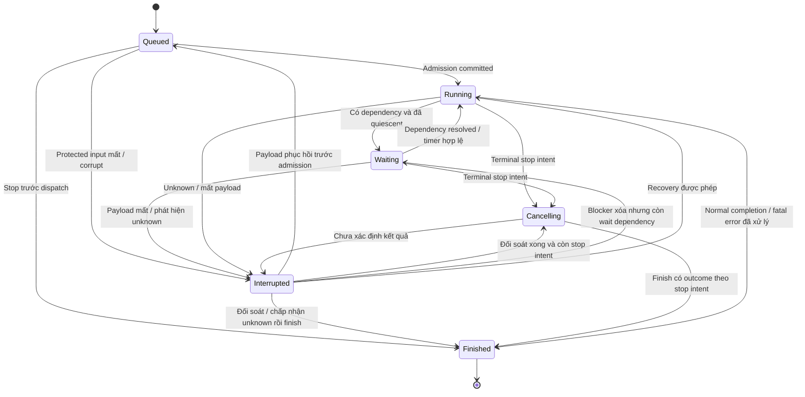
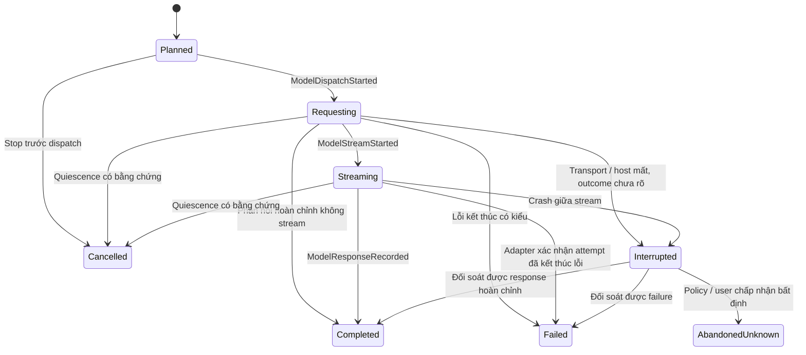
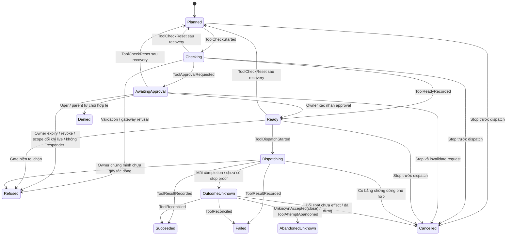

# State machine thực thi

Trạng thái: foundation semantics v0.10, chưa phải enum/API đã phát hành. Tên có thể đổi khi review; transition, invariant và recovery policy phải được giữ hoặc có quyết định thay thế. Danh mục event và chuỗi ví dụ ở [event catalog](/dev-kit/core-harness/event-catalog).

## 1. Đơn vị và facts có thẩm quyền

| Đơn vị | Định nghĩa |
| --- | --- |
| Session | Identity và lịch sử qua nhiều run; admission chỉ cho một active run |
| Run | Lần thực thi có input được nhận, cấu hình ghim, budget và outcome |
| Step | Một logical model invocation, bao gồm các retry attempts của nó, và batch tool calls/results từ phản hồi hoàn chỉnh được chọn |
| Invocation | Logical operation model/tool có ID riêng; retry không tạo logical operation mới |
| Attempt | Một lần dispatch của invocation, có ID/fence, output và usage riêng |
| Task | Công việc thuộc task domain với ownership/acceptance độc lập run |

Kernel giữ facts: run accepted/admitted/finished, stop intent, blockers, step cursor, invocation attempts, interaction references, timers và budget observations. `lifecycle`, `phase`, `waitReasons` là **projection suy ra** bằng một hàm duy nhất sau mỗi event batch, không có command tự đặt chúng. Projection có thể lưu để query nhưng phải rebuild từ facts cho cùng kết quả.

Mỗi batch chỉ có một tool ở execution frontier v1. Các tool khác có thể `Planned`, nhưng không cùng kiểm tra approval hoặc dispatch. Model output vẫn là untrusted data; chỉ phản hồi hoàn chỉnh, được validate và ghi nhận mới có thể tạo tool candidates.

## 2. Lifecycle run suy ra

Áp dụng thứ tự sau; đây cũng là precedence khi nhiều facts cùng tồn tại:

| Thứ tự | Điều kiện | Lifecycle |
| --- | --- | --- |
| 1 | Có `RunFinished` hợp lệ | `Finished` với outcome đã commit |
| 2 | Có interruption cause chưa resolve yêu cầu can thiệp/đối soát, ví dụ effect unknown chưa có disposition hoặc payload thật sự mất | `Interrupted` với danh sách lý do |
| 3 | Có terminal stop intent chưa được hoàn tất | `Cancelling`; giữ nguyên stop intent dù không còn worker và đang chờ finalization |
| 4 | Chưa có `RunAdmitted` | `Queued` |
| 5 | Còn model `Requesting/Streaming`, tool `Dispatching`, hoặc công việc quiesce đang được theo dõi | `Running`; có thể hiển thị `quiescing` |
| 6 | Có unresolved wait dependency và không có active attempt | `Waiting` cùng tập `waitReasons` |
| 7 | Run đã admitted, không thuộc các trường hợp trên | `Running`; thực hiện local transition/step tiếp theo |

Không có `RunWaitEntered/Exited` event độc lập. `ToolApprovalRequested`, timer, vault/host blocker và các resolution events làm thay đổi facts; lifecycle được suy ra từ chúng. `phase` cũng suy ra từ committed frontier theo bảng sau, độc lập lifecycle (ví dụ `Waiting/processing_tools`). Không tự gán phase từ UI hay worker.

| Phase | Điều kiện chính xác |
| --- | --- |
| `finalizing` | Đã có terminal stop/close disposition, hoặc step cuối đã đóng với next action end; phase này ưu tiên các hàng dưới và được giữ sau finish |
| `preparing` | Chưa có model invocation ở step hiện tại; gồm Queued/admitted context preparation hoặc giữa các step khi next action continue |
| `calling_model` | Model invocation hiện tại đã `ModelRequestPlanned` nhưng chưa chọn complete response hoặc đóng invocation; gồm Planned, Requesting, Streaming, retry wait và interrupted attempt |
| `processing_tools` | Response đã complete/selected, cursor còn trong batch tool results/dispositions hoặc đang đóng step đó; không phụ thuộc tool đã dispatch chưa |

`RunBlockAdded` biểu diễn wait dependency có thể resolve (vault/pause/recovery admission); `RunInterrupted` biểu diễn interruption cause cần repair/reconciliation/disposition và thắng wait theo precedence. Không gọi hai loại này chung là “blocker”.

`waitReasons` là tập dependency có kiểu, không chỉ một chuỗi: `approval`, `user_input`, `dependency`, `retry_timer`, `worker_capacity`, `vault_locked`, `host_paused`, `recovery_admission`. Từng reason có token/reference và điều kiện resolve. worker_capacity là wait dependency có pool/generation và target frontier; reserve non-blocking thất bại thì RunBlockAdded(worker_capacity), khi có slot dành riêng mới RunBlockCleared cùng dispatch transaction. Không active effect thì Waiting(worker_capacity) và đóng time window; callback stale không được clear dependency mới. Restart invalidate reservation/generation memory cũ rồi đánh giá lại capacity dưới recovery_admission, không restore một slot cũ. Read model chọn một primary reason theo thứ tự cố định để hiển thị, vẫn giữ toàn bộ tập; không mất approval chỉ vì đang pause.

Sơ đồ mô tả lifecycle quan sát được; không thay transition guards. Restart không tự chuyển `Queued` thành `Interrupted`: nếu chưa có dispatch thì không có ambiguous effect. Schema không đọc được là lỗi availability của host, không phải một domain state tự ghi vào stream mà host không hiểu.

## 3. Invariant giữa các máy

Kiểm tra sau từng **transaction event batch**, không yêu cầu mọi prefix bên trong một batch đều là trạng thái có thể dispatch.

| ID | Invariant kiểm được |
| --- | --- |
| SM-01 | V1 có tối đa một attempt model/tool tại execution frontier đang dispatch hoặc stream; timer/interaction không chiếm slot worker. |
| SM-02 | Một tool `AwaitingApproval` tương ứng đúng một unresolved approval dependency tham chiếu cùng invocation/args/request revision/check generation. Ngược lại mọi dependency loại này có đúng tool đang chờ. |
| SM-03 | Khi không có stop/interruption và không active attempt, có approval dependency thì run là `Waiting` với `approval` trong `waitReasons`. Pause/vault reasons không tạo lifecycle cạnh tranh. |
| SM-04 | `phase=calling_model` chỉ khi current step ở model frontier; `phase=processing_tools` chỉ khi phản hồi model đã `Completed` và cursor ở tool batch. |
| SM-05 | `RunFinished` chỉ hợp lệ khi mọi invocation có terminal control disposition, không còn dispatch/stream đã biết đang hoạt động, và active time window đã đóng với accounting coverage rõ ràng, và các timers/dependencies không còn quyền kích hoạt execution. |
| SM-06 | `Cancelling` chuyển sang `Finished` chỉ sau xử lý active attempts; có `OutcomeUnknown` chưa xử lý thì lifecycle là `Interrupted`, vẫn giữ stop intent. |
| SM-07 | Model request kế tiếp không dispatch trước khi step trước đã đóng và mỗi tool call có đúng một canonical result/disposition trong transcript projection. |
| SM-08 | Retry tạo attempt ID mới, giữ logical invocation ID, không ghi đè partial output/usage của attempt trước. |
| SM-09 | Completion chỉ được nhận cho đúng session admission token, executor incarnation và attempt fence; duplicate cùng kết quả không tạo event/result lần hai. |
| SM-10 | Không có dispatch mới sau terminal stop intent hoặc khi có wait/blocker chưa resolve. Gate hiện tại vẫn bắt buộc sau admission. |
| SM-11 | `Finished(abandoned_unknown)` không xóa unresolved exposure, không chứng minh process đã dừng và không release managed writer. |
| SM-12 | Run chưa admitted và chưa dispatch vẫn `Queued` sau restart; không phát sinh model/tool effect chỉ do rebuild. |

Authority và process-stop proof thuộc owning services. Không suy ra chúng từ lifecycle hoặc từ effect class của tool.

## 4. Model invocation và attempt

Logical model invocation thuộc một step; mỗi attempt có state riêng. Chỉ một attempt có thể được chọn làm response chính của invocation.

`Failed` có `failureClass`, `retryDisposition` và usage status; `Interrupted` giữ uncertainty về response/usage. Một attempt đã `Failed` không chuyển ngược về `Planned`: `ModelRetryScheduled` liên kết timer, rồi `ModelAttemptPlanned` tạo attempt mới sau timer/revalidation. `Planned` còn có thể bị admission/gateway từ chối trước request; ghi `ModelRequestFailed` với stage `pre_dispatch` và mã lý do có kiểu.

| Tình huống | Đường xử lý v1 |
| --- | --- |
| Rate limit/429 có phản hồi lỗi kết thúc rõ | `Failed(retryable)` nếu adapter/policy cho phép; honor Retry-After khi hợp lệ, kết hợp backoff hữu hạn và budget; đặt durable retry timer |
| 5xx có phản hồi lỗi kết thúc rõ | `Failed(retryable)` theo adapter classification và retry budget; không retry vô hạn |
| Auth/config/unsupported request | `Failed(fatal)`; không retry bằng timer, cần cấu hình/authority mới hoặc kết thúc run |
| Mất kết nối/crash sau dispatch, không có terminal evidence | `Interrupted`; không đoán request chưa tới provider hoặc chi phí bằng zero |
| Stream kết thúc thiếu final protocol record | `Interrupted`, trừ adapter chứng minh được một terminal failure rõ ràng |
| Retry policy cạn hoặc failure fatal | Đóng invocation bằng failure; `RunStopRequested(fatal_error)` và `RunFinished(failed)` khi mọi effect đã được xử lý |
| Có terminal stop intent trước completion | Có thể lưu response/usage hợp lệ, nhưng không tạo tool dispatch mới; outcome cuối theo stop intent |

429/5xx là input để adapter phân loại, không phải bằng chứng usage bằng zero. Model retry có thể tốn phí; reservation của attempt usage chưa rõ vẫn được giữ. Một policy riêng có thể abandon model attempt bị gián đoạn và cho attempt mới vì v1 cấm provider-hosted tools; cần budget dự trù cả chi phí cũ và mới, provenance và giới hạn hữu hạn. Không suy rộng policy này sang tool side effects.

V1 MUST tắt và từ chối provider-hosted tools: web search, code execution và remote MCP/connectors do provider tự chạy, kể cả cấu hình ngầm hoặc default SDK. Adapter phải validate capability/request trước dispatch; không chỉ bỏ qua tool-call output. Chỉ model inference và tool proposals trả về DevKit được phép trong model attempt. Nếu không bảo đảm được hợp đồng này thì provider/config không đủ điều kiện activation. Mở provider-hosted tools cần quyết định riêng về cost/effect classes, approval, receipts và unknown recovery; không áp dụng blind abandon/retry của inference-only attempt.

`ModelAttemptAbandoned(next=close)` đóng attempt, rồi cùng batch `StepAborted` đóng logical invocation bằng disposition `abandoned_unknown` (không ghi `ModelInvocationFailed` vì chưa biết failure). Nếu user `AcceptUnknown(close)`, batch cũng có `UnknownAccepted` và `RunFinished(abandoned_unknown)`. Abandon để retry giữ invocation mở; known failure mới dùng `ModelInvocationFailed`.

Mọi partial output gắn `invocationID/attemptID/chunkSequence`; không trộn chunks của hai attempts. Deltas thường là ephemeral; phần cần giữ được lưu dưới protected partial-output ref. Partial text hiển thị là interrupted draft, không là canonical assistant response và không tạo executable tool call. Chỉ `ModelResponseRecorded` đưa phản hồi hoàn chỉnh được chọn vào transcript projection.

## 5. Tool invocation và effect class

Check/request/execute dùng cùng gateway với one-use receipt như [approval protocol](/dev-kit/core-harness/architecture#approval-qua-owning-gateway); `Ready` không cấp quyền bền vững. Current execute revalidation dùng receipt hợp lệ cho đúng execution, không gọi lại blocking confirmation gây hỏi đôi. Receipt stale khi execute do authority hiện tại vẫn có thể tạo refusal. Restart pre-dispatch dùng ToolCheckReset, không tạo canonical refused chỉ vì host chết; denial/refusal đã commit trước crash vẫn terminal.

`Denied` là quyết định từ chối của approver có thẩm quyền; `Refused` là validation/gateway/owner không cho thực thi, bao gồm request hết hạn, owner thu hồi hoặc scope đổi khi đang live; restart invalidation riêng dùng ToolCheckReset, không đi cạnh Refused. Cả hai có result có kiểu cho model và không giả làm lỗi executor. `Failed` là attempt kết thúc lỗi; không dùng nó để che một outcome còn unknown. `Cancelled` cần nêu pre-dispatch hoặc evidence dừng, không do timeout đơn thuần.

Sơ đồ trên áp dụng cho tool attempt. Invocation đóng theo selected terminal disposition; retry tạo attempt mới, không chuyển ngược hoặc ghi đè state của attempt cũ. `ToolCheckReset` là ngoại lệ cho `Checking`, `AwaitingApproval` và `Ready` chưa dispatch sau recovery: owner invalidate/read-back request/receipt/reservation cũ, gỡ dependency cùng batch và tăng check generation trước khi về Planned; rồi check lại cùng attempt; không phải retry effect.

Tool descriptor có `effectClass` do host registry sở hữu, được ghim theo version; model/client không được tự khai báo class để nới recovery. Default cho tool chưa phân loại là `side_effecting`.

| Class | Hợp đồng | Recovery unknown |
| --- | --- | --- |
| `pure_read` | Không ghi external/domain state theo contract đã review; vẫn có scope, secrets, I/O, resource/cost limits | Host policy có thể ghi `ToolAttemptAbandoned` và tạo attempt mới nếu cần; giữ evidence unknown cũ, kiểm tra scope/pause/budget hiện tại |
| `idempotent` | Có contract lặp lại cùng logical operation, cùng input và idempotency key/window thật sự được owner hỗ trợ | Đối soát trước; retry chỉ nếu contract và window còn hiệu lực. Hết window hoặc đổi input thì xử lý như side_effecting |
| `side_effecting` | Có thể gây thay đổi không chứng minh lặp an toàn | Không tự retry unknown; đối soát hoặc explicit `AcceptUnknown` |

Class không xác nhận process đã dừng, không thay gateway và không bảo đảm read lại cùng dữ liệu. Tool shell/script không được gắn `pure_read` chỉ vì arguments trông như lệnh đọc. Policy abandon không được giải phóng write/resource ownership mà owner chưa cho phép.

Terminal control dispositions của invocation là success, known failure, denied/refused, cancelled, hoặc `AbandonedUnknown` có disposition event. Unknown exposure vẫn được lưu trên original invocation projection để đối soát sau đó; không tạo effect ledger cạnh tranh.

## 6. Stop intent và outcome

`RunStopRequested` chứa `stopReason`, `mode`, actor/origin, source/reference và request time. `stopReason` đề xuất: `user_cancel`, `parent_cancel`, `budget`, `fatal_error`, `shutdown`. Các reason đầu là `mode=terminal`; `shutdown` là `mode=suspend`, đi cùng blocker `host_paused` và yêu cầu quiesce. Terminal request được chấp nhận đầu tiên là primary reason; các trigger terminal sau là secondary facts. Suspension không chiếm primary terminal reason, nên user vẫn có thể cancel một run đang chờ sau shutdown. Budget và gateway vẫn cưỡng chế giới hạn thực thi dù primary là user cancel; chúng không ghi đè primary reason hoặc tự đổi outcome đã chọn theo bảng dưới.

| Primary reason / disposition | Kết quả khi đã xử lý effects |
| --- | --- |
| `user_cancel`, `parent_cancel` | `cancelled`, giữ actor và reason |
| `budget` | `budget_exceeded` |
| `fatal_error` | `failed` với typed failure reference |
| `shutdown` (suspension, không primary terminal) | Không tự `RunFinished`; khi quiescent vào `Waiting(host_paused)`, hoặc interrupted nếu unknown; resume hợp lệ clear blocker và suspension liên kết |
| Đóng metadata-only, không có unknown exposure/usage | `abandoned`, reason unavailable; không phải cancelled/success |
| Chấp nhận unknown để đóng | `abandoned_unknown`, giữ nguyên stop intent trước đó nếu có; không giả làm cancelled |
| Không có stop, continuation kết thúc bình thường | `completed` |

Completion và stop race được quyết định bởi thứ tự commit: nếu đã `RunFinished`, stop mới bị từ chối/no-op có receipt; nếu stop commit trước, response đến sau không tự mở tool loop. Stop cho run đang `Queued` có thể finish trong cùng event batch mà không dispatch.

`Cancelling` không ngăn mọi external call tức thì. `DispatchStarted` commit trước stop nghĩa attempt có thể đã ra ngoài dù worker chưa được giao; host gửi cancellation hoặc ghi evidence pre-handoff chưa dispatch nếu chứng minh được trong cùng incarnation. Sau restart, mất bằng chứng handoff thì phải coi là unknown.

`AcceptUnknown` là command riêng của user qua trusted UI/host, target đúng run/invocation/attempt và revision; phải liệt kê uncertainty được chấp nhận. Đường `AcceptUnknown` thông thường yêu cầu vault mở để trusted host dựng preview từ protected exact args/target và evidence của attempt; không dùng preview cũ. Khi không đọc được payload, user có đường `CloseRunWithoutPayload` bên dưới; không giả có exact preview. Event `UnknownAccepted` ghi actor và disposition. V1 không cho model/parent tự chấp nhận unknown của thao tác ghi. Chấp nhận để **đóng** run khác với cho phép retry một thao tác ghi; lần chạy mới vẫn phải qua approval và ownership hiện tại.

### Worker treo trong incarnation hiện tại

V1 không có primitive kill goroutine hoặc host-policy force-abandon một worker còn được biết đang chạy. Request cancellation có timeout chỉ là yêu cầu, không là stop proof. Với subprocess, owning service có thể kill/cancel và báo terminal/quiescence evidence nếu contract của nó thật sự hỗ trợ, bao gồm descendants/resource guards cần thiết. Nếu worker vẫn treo hoặc owner không chứng minh được đã dừng thì CloseRunWithoutPayload báo cần restart host và chưa ghi RunFinished/clear admission; không tự chuyển sang unknown chỉ để vượt SM-05. Sau process restart thực sự và exclusive lock acquisition, recovery classify attempt thiếu completion là unknown; user mới có thể đóng control theo đường metadata-only. Restart không chứng minh subprocess/external effect dừng và không release resource ownership. Đây là giới hạn v1 phải hiển thị trong failure UX G-07, không hứa stop được worker bất kỳ.

### Đóng control khi không đọc được payload

V1 MUST hỗ trợ `CloseRunWithoutPayload`, kể cả vault khóa, mất/hỏng payload hoặc user không còn mở được vault. Đây là command riêng qua trusted user UI/host đã xác thực local session ownership; không cần Master Password, không cấp quyền đọc vault. Model, parent, worker và generic MCP caller không được gọi thay user; headless/nil trusted responder fail closed. Không yêu cầu user chứng minh quên mật khẩu: reason chỉ là enum `vault_locked`, `payload_missing` hoặc `payload_corrupt`, không lưu free text.

Host dựng metadata-only preview mới từ control history: run/session IDs, revision, registry tool identifier (nếu còn), invocation/attempt IDs, dispatched/unknown facts và lý do không có args preview. Không lộ target/args, không fabricate tên tool khi metadata thiếu. User xác nhận rõ **đóng control dù không xem được nội dung và không biết hết tác động**. Command bind exact run revision và tập attempts/interruption causes, preview version và explicit metadata-only acknowledgement, có metadata-only dedup receipt. Metadata/protocol không đọc được thì dùng diagnostic unavailable, không đoán hoặc ghi đè history.

Coordinator ghi `RunClosureConfirmed(preview=metadata_only)` cùng terminal dispositions: planned work thành cancelled-before-dispatch, unknown attempts thành abandoned_unknown (effect_unknown cause được disposition accepted_unknown), missing-context cause được disposition `closed_unavailable` (không nói payload đã phục hồi), rồi `StepAborted` nếu có step, cancel timers/dependencies và `RunFinished`. Outcome là `abandoned_unknown` nếu còn exposure/usage unknown, còn lại `abandoned`; giữ primary stop provenance, không bịa success/refusal hoặc zero usage. Mọi known live worker phải quiesce có evidence trước finish theo SM-05; thiếu stop proof phải giữ/ghi unknown bằng owner evidence, không giả đã dừng. Finish clear đúng control admission của run, **không release managed writer/resource guards**, không dispatch/retry, không xóa payload/history.

Batch đóng MUST ghi đủ fixed typed dispositions trong control/transcript projection **không cần mở hoặc ghi protected payload**; không dựng canonical content giả cho phần bị mất. Close run đã admitted trong current epoch cập nhật context requirement trên session admission row cùng transaction (Queued input chưa vào transcript thì không đổi requirement): payload_missing/corrupt đặt fresh_required; chỉ vault_locked đặt revalidation_required, không buộc bỏ context còn nguyên. SelectRunContext chọn fresh hoặc continue (continue chỉ sau unlock/validation đầy đủ), ghi ContextBoundarySelected cùng admission của run mới theo storage §3. Không dùng một session flag không có owner/event; đóng run không khôi phục dữ liệu hay Master Password. G-03/G-07 phải kiểm chứng đường thoát này ngay trong v1.

Run có thể `Finished(abandoned_unknown)` trong khi external exposure còn chưa rõ. Admission fence có thể ngăn old callback ghi transcript, nhưng managed writer/resource owner vẫn giữ quyền chặn công việc xung đột cho đến khi có stop/reconciliation proof. Một pure read không tạo writer ownership chỉ vì bị unknown.

## 7. Timer là facts bền vững

V1 dùng **active execution budget**, không dùng elapsed wall time từ RunAccepted. Không charge thời gian Queued, process đã chết, `recovery_admission`, hoặc quiescent waits (approval/input/vault/pause/retry/capacity). Khi có model/tool đang chạy hoặc đang quiesce thì thời gian vẫn charge dù UI đang pause/lock; không suy ra external effect ngừng tốn tài nguyên chỉ vì host ngừng đo. Context building/local loop sau authorization cũng charge, để không né budget bằng công việc trước dispatch.

Host mở một time-budget window khi run admitted, resume được queue owner cho phép và có work runnable/active. `TimeBudgetWindowOpened` giữ chỗ một tranche hữu hạn từ remaining budget, bind window ID/generation/incarnation và policy; cùng batch `TimerScheduled(run_deadline)` cho tranche đó. Không tạo run deadline lúc RunAccepted. Trusted host đo elapsed bằng monotonic clock trong cùng incarnation; `BudgetObserved` checkpoints và `TimeBudgetWindowClosed` đối soát elapsed, trả phần reserve chưa dùng có evidence. Không double-count window hoặc mở tranche tiếp trước commit accounting của tranche trước. Khi vào quiescent wait/finish thì đóng window và cancel timer; khi resume mở window/generation mới từ **remaining**, không reset tổng budget.

`run_deadline` chỉ là timer của **active window**, không tạo wait dependency. Timer/dispatch checks dùng trusted monotonic elapsed của window, không dùng clock wall jump để charge budget; UTC deadline là scheduler hint có thể dựng lại trong incarnation đó. `TimerElapsed(run_deadline)` đóng/charge window; nếu còn budget và vẫn runnable thì có thể mở tranche tiếp, nếu exhausted thì cùng batch `RunStopRequested(budget,terminal)` và quiesce active effects. Timer không chứng minh effect đã dừng.

Crash làm mất monotonic baseline. Recovery MUST invalidate old window timer generation, ghi `TimeBudgetWindowClosed(coverage=unknown)` cho tail chưa checkpoint và giữ outstanding reservation; **không lấy now-minus-old-UTC để charge downtime, không auto budget-stop hoặc mở window trước quyết định resume**. Trên explicit resume, v1 bảo thủ charge outstanding tranche bằng `BudgetObserved(basis=reserved_after_crash)`, ghi rõ là conservative charge chứ không là measured elapsed; chỉ phần remaining sau charge mới được dùng. Nếu hết thì trả budget-exceeded disposition thay vì dispatch. User cũng có thể close run; không silent release unknown thành zero. Tranche size ảnh hưởng sai số charge và phải được ghim/review G-02/G-03. Đây là ngân sách phân bổ, không cam kết đo chính xác tail đã mất hoặc hard-stop được external effect qua crash; unknown cost/resource exposure vẫn đối soát riêng.

`purpose` v1 gồm `model_retry`, `tool_retry`, `run_deadline` và owner-linked dependency/approval expiry. Retry/approval expiry vẫn là absolute UTC/lifetime theo contract riêng; elapsed của chúng không tự charge active budget hoặc cấp resume.

`TimerScheduled` chứa timer ID, generation, purpose, target invocation/request/window, UTC scheduling deadline và policy version; run_deadline có monotonic window/duration reference theo contract trên. `TimerFired` là **command của host**, không phải event tự xuất hiện; khi được nhận hợp lệ, coordinator ghi `TimerElapsed`. Timer bị thay/hủy có `TimerCancelled` và generation mới. `TimerFired` của admitted run dùng admission token hiện tại; nếu target vẫn Queued thì dùng queue-owner authority và expected run/session-queue revisions, không mượn token của active run khác.

Host clock/scheduler nằm ngoài kernel. Command mang `observedNow` từ trusted clock port; kernel kiểm tra clock domain, elapsed/deadline, generation và fence dựa trên input này; run_deadline dùng window-bound monotonic observation, các purpose UTC dùng observedNow. Command đến sớm bị từ chối; trùng hoặc timer đã hủy không gây bước mới. Replay không chạy scheduler hoặc callback.

Sau restart, host chỉ re-arm unresolved UTC timers còn hợp lệ; run_deadline của incarnation cũ bị invalidate, không re-arm từ UTC hint. UTC timer quá hạn có thể gửi command, không tự resume work. Timer elapsed chỉ resolve time dependency: pause, vault, current scope và budget vẫn có thể ngăn dispatch. Approval expiry do interaction owner xác nhận bằng lifetime hiện tại; timer không kéo dài hoặc khôi phục request cũ.

Retry backoff/jitter được host tính và ghi thành deadline đã chọn; replay không random lại. Cancellation, finish và unknown disposition phải cancel các timer có thể làm sống lại execution.

## 8. Vault lock, pause và recovery blockers

Vault lock tạo `RunBlockAdded(vault_locked)` từ observation của vault owner, ngăn dispatch mới ngay khi host xử lý; owning service vẫn kiểm tra lock ở boundary thực thi. Host yêu cầu quiesce/cancel effects cần secrets qua `InvocationQuiesceRequested(reason=vault_lock)`; đây là suspension, không phải terminal user cancel.

Khi còn request/stream/tool đang dừng, lifecycle vẫn `Running(quiescing)`; khi đã quiescent và không có unknown thì `Waiting(vault_locked)`. Nếu quiesce không xác định được kết quả, `Interrupted(effect_unknown)` giữ cả vault blocker. Không ép state `Waiting` trong khi worker vẫn chạy chỉ để hiển thị khóa vault.

Vault unlock không tự tiếp tục: owner cung cấp observation, host đọc lại payload/credentials và revalidate scope/queue; `RunBlockCleared` chỉ gỡ blocker nếu hợp lệ. Secret bị mất thật sự khác với tạm không đọc được do vault khóa: missing/deleted payload tạo interruption; restored payload cần validation mới clear.

Vault khởi tạo locked ở mỗi process start, nhưng user có thể unlock trước khi recovery chạy. Recovery MUST subscribe/read trạng thái **hiện tại** kèm revision từ vault owner theo consistent-view/catch-up contract; batch lấy ownership luôn thêm `recovery_admission`, chỉ thêm/giữ `vault_locked` nếu owner đang locked (hoặc unknown/unavailable, fail closed). Nếu owner đã unlocked thì clear blocker cũ bằng current revision evidence, không chờ một unlock event tương lai. Trước scheduling phải catch-up/revalidate revision; lock mới hơn luôn chặn tại service boundary. Với unknown, lifecycle ưu tiên `Interrupted` và giữ các wait reasons còn thực sự unresolved. Unlock chỉ gỡ vault reason; queue/scope vẫn phải cấp resume.

| Tình huống restart / mất khả dụng | Đường xử lý |
| --- | --- |
| Run `Queued`, chưa dispatch | Giữ `Queued`; đợi admission và queue policy hiện tại |
| Run admitted, chỉ có intents `Planned/Checking/Ready` chưa dispatch | Reacquire admission fence; thêm recovery_admission và đồng bộ vault blocker theo owner revision, reset check generation/receipt cũ và recheck sau unlock/resume; không invent unknown |
| Tool `Checking/AwaitingApproval/Ready` sau restart | Owner read-back/invalidate mọi request/receipt/reservation kể cả chưa ghi receipt; ToolCheckReset cùng dependency resolution về Planned và generation mới; recheck sau unlock/resume, không synthetic refused; callback check/approval cũ bị fence |
| Model `Requesting/Streaming` hoặc tool `Dispatching` không có completion | Attempt interrupted/unknown theo class/policy, không replay side effect |
| Chỉ vault khóa | `Waiting(vault_locked)` khi quiescent; không gán corruption hoặc payload lost |
| Payload đã mất/corrupt | `Interrupted(payload_unavailable)`; phục hồi reference hợp lệ hoặc trusted user CloseRunWithoutPayload để đóng admission, giữ missing-data provenance |
| Schema/protocol không hỗ trợ | Host báo stream unavailable/read-only diagnostic; không append state event mà decoder không hiểu |

Hủy run cha không tự hủy mọi child hoặc release task. Team cascade cancellation tiếp tục thuộc owner và authority hiện hữu. Task acceptance, push/merge và writer release không suy ra từ lifecycle, lease expiry hoặc `UnknownAccepted`.

## 9. Budgets và transcript ordering

Budget theo model attempts/steps, tokens/cost, tool calls, retries, time và concurrency. Kiểm tra trước dispatch, reserve phần đang hoạt động, đối soát usage khi có. Cả `ModelDispatchStarted` và `ToolDispatchStarted` MUST có reservation identity/counters cho attempt, commit cùng dispatch; reservation chưa rõ được giữ cho đến owner/accounting evidence, không hoàn chỉ vì restart/abandon. Tool-call count được charge khi dispatch commit; pre-handoff proof có thể release phần resource chưa dùng theo policy, không xóa lịch sử attempt. Unknown usage không được ghi zero; accounting reconciliation có thể bổ sung evidence sau khi run đóng mà không khởi động lại loop.

Transcript native là projection cùng event transaction; chỉ canonical model responses và tool results/dispositions được dùng làm provider context. Partial drafts thuộc attempt view. Tool calls không còn chạy do stop cần synthetic disposition có kiểu trước `StepCompleted`, không bịa tool success.

V1 chỉ một execution frontier. Khi thêm parallelism, cần review lại SM-01/SM-03, approval dependencies và resource guards; journal có completion order, transcript vẫn có tool source order. Child completion claim không tự biến thành acceptance của task.
